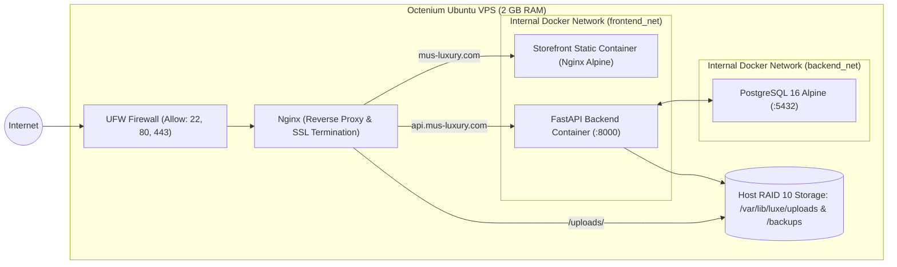

# MUS LUXURY (`LUXE`) — FULL CODEBASE AUDIT & DEPLOYMENT DISCOVERY REPORT

**Target Platform:** Mus Luxury E-Commerce & Retail ERP Monorepo  
**Production Host:** Octenium Ubuntu VPS (1 Intel Xeon vCore, 2 GB RAM, 40 GB NVMe, Fixed Public IPv4)  
**Production Domain:** `mus-luxury.com`  
**Audit Date:** November 9, 2026  
**Auditor Roles:** Senior Software Architect, DevOps Engineer, Database Architect, Application Security Engineer  
**Status of Working Tree:** Clean (Inspected on branch `feat/pos-core-cash-register` at commit `11eaccc`)  

---

## 1. Operating Rules & Verification Standard

This audit adheres to strict non-destructive inspection rules:
- **Zero Modification Mode:** No codebase logic, configurations, or packages were altered or updated during the production readiness audit.
- **Credential Protection:** No secret keys, credentials, private API tokens, or passwords from `.env` files are printed or exposed.
- **Evidence-Based Categorization:** Every architectural finding, performance metric, and vulnerability is substantiated with exact file paths, line numbers, and verified execution commands using the standard taxonomy:
  - `[VERIFIED]`: Directly proven by source inspection, build execution, or unit test.
  - `[PARTIALLY VERIFIED]`: Implemented in code but dependent on unverified external infrastructure or missing runtime libraries.
  - `[NOT IMPLEMENTED]`: Absent from code and configurations.
  - `[UNKNOWN]`: Requires information external to the repository (e.g., DNS provider, hosting dashboard).
  - `[BLOCKER]`: Critical defect or misconfiguration that will cause production failure if not remediated before deployment.

---

## A. Executive Summary

Mus Luxury (`luxe-ecommerce`) is an enterprise-grade monorepo combining an Algerian e-commerce storefront, an omnichannel retail ERP, and a physical boutique Point-of-Sale (POS) cash register.

### Architectural Composition
1. **Public Storefront (`apps/storefront`):** A single-page customer web application optimized for mobile and desktop, supporting French, Arabic (RTL), and English. Built around Algerian e-commerce realities: guest Cash-on-Delivery (`COD`) checkout across 69 Wilayas (1,541 communes), carrier fee calculation, promo coupons, and phone-based anti-return scoring.
2. **Native Desktop CMS & POS (`apps/desktop-cms`):** A native Windows desktop application built with **Tauri 2.0 (Rust) + React 18**. Designed for installation on the physical store owner's PC. It does not connect directly to any database; instead, it interfaces exclusively with the Python cloud API via Bearer tokens and HMAC signatures, embeds an offline SQLite catalog mirror (`pos_mirror.sqlite3`), queues offline sales locally, and interfaces directly with ESC/POS thermal printers, cash drawers, and ZPL II label printers.
3. **Cloud Backend API (`backend/`):** A asynchronous **FastAPI** service operating over **PostgreSQL 16** (production) or **SQLite 3** (local dev/test). Exposes 163 REST endpoints governing store layout, dynamic category attribute modeling, inventory movement ledgers, purchase orders, cashier sessions, sales reports, expenses, audit trails, and automated database backups.
4. **Current Maturity Level:** **Late Stage / Pre-Production**. All core retail ERP modules, cashier workflows, offline sync mechanisms, and hardware drivers are fully written. However, three critical deployment blockers (domain name discrepancy, uncompiled Docker assets, and unconfigured updater signing keys) must be resolved prior to launch.

---

## B. Technology Stack

| Layer / Component | Technology | Detected Version | Purpose & Verification Location | Evidence Status |
| :--- | :--- | :--- | :--- | :--- |
| **Backend Runtime** | Python (CPython) | `3.11.x` (`Dockerfile:1`) | API execution runtime | `[VERIFIED]` |
| **Web Framework** | FastAPI | `>=0.92.0, <0.100.0` | High-performance ASGI REST API (`backend/requirements.txt:1`) | `[VERIFIED]` |
| **ASGI Server** | Uvicorn (standard) | `>=0.20.0, <0.30.0` | HTTP/1.1 and WebSocket ASGI server (`backend/requirements.txt:2`) | `[VERIFIED]` |
| **Data Validation** | Pydantic | `>=1.10.4, <2.0.0` | DTO and request body schema enforcement (`backend/requirements.txt:3`) | `[VERIFIED]` |
| **Database Driver** | Psycopg 3 (`psycopg[binary]`) | `>=3.1.0` | Native PostgreSQL 16 connection client (`backend/requirements.txt:6`) | `[VERIFIED]` |
| **Database Engine** | PostgreSQL / SQLite | Postgres 16-alpine / SQLite 3 | Dual-engine support via abstraction layer (`backend/app/database.py:8-266`) | `[VERIFIED]` |
| **ORM / Query Layer** | Pure SQL (Parameterized) | N/A (No ORM used) | Parameterized SQL with auto-translation for Postgres compatibility | `[VERIFIED]` |
| **Cryptography** | `cryptography` / `hashlib` | `>=38.0.0` / Stdlib | PBKDF2-HMAC-SHA256 (600,000 iter), Fernet, HMAC-SHA256 | `[VERIFIED]` |
| **Desktop Shell** | Tauri 2.0 (Rust 2021) | `2.0.0` | Native Windows desktop wrapper and OS bridge (`apps/desktop-cms/src-tauri/Cargo.toml:1-35`) | `[VERIFIED]` |
| **Embedded Client DB** | `rusqlite` (bundled) | `0.32` | Local product/variant cache for offline POS operation (`Cargo.toml:29`) | `[VERIFIED]` |
| **Desktop OS Keychain**| `keyring` (windows-native)| `3.0` | Hardware-backed token storage via Windows Credential Manager (`wincred`) | `[VERIFIED]` |
| **Printer Subsystem** | `printers` (Rust crate) | `2.0` | System print spooler discovery for ESC/POS and ZPL II | `[VERIFIED]` |
| **CMS Frontend** | React / TypeScript | `18.3.1` / `5.5.3` | CMS interface (`apps/desktop-cms/package.json:15`) | `[VERIFIED]` |
| **Storefront App** | Vanilla JS / React hybrid | React `18.3.1` (Vite) | 4,387-line optimized HTML/JS app referencing compiled Tailwind CSS | `[VERIFIED]` |
| **Frontend Build Tool**| Vite | `5.3.4` (CLI: `5.4.21`) | Asset bundling and PostCSS compiler (`apps/storefront/package.json:28`) | `[VERIFIED]` |
| **Styling Engine** | Tailwind CSS / PostCSS | `3.4.6` / `8.4.39` | Build-time compilation of luxury theme palette | `[VERIFIED]` |
| **Icons Library** | Lucide React | `^0.400.0` | Visual iconography throughout Storefront and CMS | `[VERIFIED]` |
| **Reverse Proxy** | Nginx | `1.27-alpine` | TLS termination, rate-limiting, and static file serving (`docker-compose.yml:63`) | `[VERIFIED]` |

---

## C. Project Structure

```text
luxe-ecommerce/
├── .github/
│   ├── workflows/
│   │   ├── ci.yml                     # Consolidated CI (Lint, Migrations, SQLite & PG16 tests)
│   │   ├── cd-staging.yml             # Automatic staging deployment pipeline
│   │   ├── cd-production.yml          # Production deployment pipeline with approval gate
│   │   └── build-desktop-cms.yml      # Windows Tauri 2 MSI/NSIS build & release workflow
│   ├── dependabot.yml                 # Automated dependency updates
│   ├── pull_request_template.md
│   └── CODEOWNERS
├── apps/
│   ├── desktop-cms/                   # Native Windows Desktop CMS & POS Application
│   │   ├── src/                       # React 18 + TypeScript frontend
│   │   │   ├── api/adminClient.ts     # Centralized authenticated API client
│   │   │   ├── components/            # Modals (BarcodeLabel, PrinterSettings, VariantManager)
│   │   │   ├── pages/                 # 24 Functional tabs (PosPage, Purchases, Inventory...)
│   │   │   └── utils/                 # posHardware, posMirror, posOfflineQueue, osKeychain
│   │   ├── src-tauri/                 # Tauri 2.0 Rust native backend
│   │   │   ├── src/main.rs            # Entry point & IPC command registrations
│   │   │   ├── src/pos_hardware/      # ESC/POS receipt & ZPL II label printer drivers
│   │   │   ├── src/pos_mirror/        # Embedded SQLite catalog mirror (rusqlite)
│   │   │   ├── Cargo.toml             # Rust dependencies (rusqlite, keyring, printers)
│   │   │   └── tauri.conf.json        # Window specs, CSP, and updater endpoint
│   │   ├── package.json               # Node dependencies
│   │   └── vite.config.ts             # Vite build configuration (port 1420)
│   └── storefront/                    # Public Cash-on-Delivery Customer Storefront
│       ├── index.html                 # 4,387-line self-contained single-page storefront app
│       ├── Dockerfile                 # Multi-stage production container build
│       ├── package.json
│       ├── tailwind.config.js         # Compiled luxury design tokens
│       ├── vite.config.ts             # Vite configuration
│       └── src/
│           ├── api/client.ts          # Public API communication layer with retry/timeout
│           ├── App.tsx / main.tsx     # React storefront implementation
│           └── index.css              # PostCSS Tailwind entry point
├── backend/                           # Cloud FastAPI Backend
│   ├── app/
│   │   ├── main.py                    # API entrypoint (8,297 lines, 163 routes)
│   │   ├── database.py                # Database connection layer (Postgres 16 & SQLite 3)
│   │   ├── migration_runner.py        # Forward-only versioned migration engine
│   │   ├── security.py                # PBKDF2 hashing, JWT signing, rate limiting, HMAC
│   │   ├── seed.py                    # Initial seed data (roles, permissions, settings)
│   │   ├── algeria_communes.py        # Complete official dataset of 1,541 Algerian communes
│   │   └── whatsapp.py                # Meta WhatsApp Cloud API integration
│   ├── migrations/
│   │   ├── 001_initial_schema.sql             # SQLite baseline schema
│   │   ├── 001_initial_schema_postgres.sql    # PostgreSQL 16 baseline schema (41 tables)
│   │   └── versions/                          # Forward-only migration files
│   ├── tests/                         # 27 Test suites (unit, integration, AST audits)
│   ├── uploads/                       # Local media directory for product images
│   ├── backups/                       # Local compressed database backup storage
│   ├── Dockerfile                     # Python 3.11-slim container definition
│   └── requirements.txt               # Locked Python dependencies
├── docs/                              # Technical documentation
│   ├── cicd/                          # 13 CI/CD, release, rollback, and hardware guides
│   ├── API_INVENTORY.md               # Categorized endpoint inventory
│   └── openapi.json                   # Exported OpenAPI 3.0 specification
├── infrastructure/                    # Deployment & VPS management assets
│   ├── environments/                  # .env templates (development, staging, production)
│   ├── nginx/nginx.conf               # Hardened reverse-proxy configuration
│   ├── monitoring/                    # Lightweight Prometheus/Node-exporter compose
│   └── scripts/                       # Shell scripts (vps-bootstrap, release-deploy, rollback)
├── docker-compose.yml                 # Production multi-container orchestration
└── ruff.toml                          # Python linter and formatter configuration
```

---

## D. Architecture and Data Flow

```mermaid
flowchart TD
    subgraph ClientLayer ["Client Access Layer"]
        Customer["Public Customer (Browser/Mobile)"]
        POSCashier["Cashier / Store Manager (Windows PC)"]
    end

    subgraph DesktopApp ["Apps: Desktop CMS (Tauri 2 + Rust)"]
        CMS_UI["React 18 Admin & POS Interface"]
        WinCred["Windows Credential Manager (wincred)"]
        LocalMirror["Local SQLite Mirror (pos_mirror.sqlite3)"]
        OfflineQueue["Durable Local Storage Queue"]
        PrinterBridge["Hardware Bridge (ESC/POS & ZPL II)"]
        
        CMS_UI <--> WinCred
        CMS_UI <--> LocalMirror
        CMS_UI <--> OfflineQueue
        CMS_UI --> PrinterBridge
    end

    subgraph EdgeLayer ["VPS Edge: Nginx Reverse Proxy (:80, :443)"]
        Nginx["Nginx 1.27 (Reverse Proxy & TLS Engine)"]
        RateLimiter["Sliding Window Rate Limiters"]
        StaticMedia["/uploads/ (Local Media Cache)"]
    end

    subgraph ServiceLayer ["VPS Application Services (Docker / Systemd)"]
        StorefrontApp["Storefront Static Web Service"]
        FastAPI["Python 3.11 FastAPI Backend (:8000)"]
    end

    subgraph DataLayer ["Data & External Integration Layer"]
        PostgresDB[("PostgreSQL 16 Database (:5432)")]
        WhatsAppAPI["Meta WhatsApp Business Cloud API"]
        LocalDisk[("Host RAID 10 Storage (/var/lib/luxe)")]
    end

    subgraph RetailHardware ["Physical Retail Peripherals"]
        ReceiptPrinter["80mm ESC/POS Thermal Receipt Printer"]
        CashDrawer["RJ11/RJ12 Cash Drawer"]
        BarcodeScanner["USB-HID Barcode Scanner"]
        LabelPrinter["Zebra / GoDEX ZPL II Label Printer"]
    end

    Customer -->|HTTPS: mus-luxury.com| Nginx
    POSCashier --> CMS_UI
    BarcodeScanner -.->|Keystroke emulation| CMS_UI
    PrinterBridge -.->|System Spooler / Raw Port| ReceiptPrinter
    PrinterBridge -.->|ESC p pulse| CashDrawer
    PrinterBridge -.->|ZPL II Bytecode| LabelPrinter

    CMS_UI -->|HTTPS: api.mus-luxury.com (Bearer + HMAC)| Nginx
    Nginx --> RateLimiter
    Nginx -->|/ (HTML/CSS/JS)| StorefrontApp
    Nginx -->|/uploads/*| StaticMedia
    Nginx -->|/api/v1/*| FastAPI

    FastAPI <-->|psycopg 3 (Parameterized SQL)| PostgresDB
    FastAPI -->|Media & Backups| LocalDisk
    FastAPI -.->|HTTPS REST| WhatsAppAPI
    StaticMedia --> LocalDisk
```

### Data Flow Analysis
1. **Catalog Synchronization:**
   - Public Storefront requests layout and catalog data on demand with HTTP cache headers.
   - Desktop CMS pulls initial snapshot (`GET /api/v1/admin/pos/catalog/snapshot`), then continuously synchronizes incremental changes every 30 seconds (`GET /api/v1/admin/pos/catalog/deltas?since=<cursor>`).
2. **Order Placement (Online Storefront):**
   - Customer submits order (`POST /api/v1/orders`).
   - Server validates Algerian phone number format, checks idempotency key, locks variant stock atomically (`BEGIN IMMEDIATE` / serial transaction), records an audit row in `inventory_movements`, and generates a tracking reference.
3. **In-Store Sales (POS Cash Register):**
   - **Online:** Scans barcode, resolves SKU via local mirror or API (`GET /api/v1/admin/pos/lookup`), and immediately posts `POST /api/v1/admin/pos/sales`. Server deducts stock, prints an 80mm ESC/POS receipt, and sends the cash drawer pulse.
   - **Offline:** The POS resolves items from `pos_mirror.sqlite3`, writes the sale into `luxe_pos_offline_queue` with a unique `client_txn_id`, prints the receipt offline, and queues the transaction. When online, `syncPosQueue()` calls `POST /api/v1/admin/pos/sync`. Duplicates are handled idempotently; valid sales are committed; conflicts are surfaced in the UI for review.

---

## E. Desktop CMS Findings (Critical)

| Category | Finding & Implementation Details | Evidence Location | Status |
| :--- | :--- | :--- | :--- |
| **Framework** | Native desktop app built with **Tauri 2.0 (Rust 2021) + React 18**. | `apps/desktop-cms/src-tauri/Cargo.toml:1-35`, `main.rs:1-110` | `[VERIFIED]` |
| **Database Connection** | **Zero direct database connections.** The desktop app never connects to PostgreSQL directly; all access is routed through authenticated REST endpoints. | `apps/desktop-cms/src-tauri/src/main.rs:5-12` | `[VERIFIED]` |
| **Local Database Engine**| Embedded **SQLite** database managed in pure Rust via `rusqlite` (bundled feature). Located at `<app_data_dir>/pos_mirror.sqlite3`. | `apps/desktop-cms/src-tauri/src/pos_mirror/mod.rs:1-32` | `[VERIFIED]` |
| **Offline Capability** | Fully capable of product/variant lookups, price checks, and recording sales with zero internet connection. | `pos_mirror/mod.rs:18-20`, `apps/desktop-cms/src/pages/PosPage.tsx:1-321` | `[VERIFIED]` |
| **Offline Queue** | Durable queue stored under `luxe_pos_offline_queue` in `localStorage`. Items survive app reboots and system crashes. | `apps/desktop-cms/src/utils/posOfflineQueue.ts:1-45` | `[VERIFIED]` |
| **Deduplication** | Every offline transaction generates a unique `client_txn_id` (`postxn-<timestamp>-<rand>`). The backend sync route is idempotent. | `posOfflineQueue.ts:92-95` | `[VERIFIED]` |
| **Conflict Resolution**| Transactions rejected by server business logic (e.g., stock sold out online during the outage) transition to `status: "conflict"`. They are **never discarded** silently and require cashier intervention. | `posOfflineQueue.ts:178-185` | `[VERIFIED]` |
| **Receipt Printer** | Native ESC/POS driver supporting both Windows Print Spooler system printers and raw COM/USB device paths. | `apps/desktop-cms/src-tauri/src/pos_hardware/escpos.rs:1-233` | `[VERIFIED]` |
| **Cash Drawer** | RJ11/RJ12 drawer kick command triggered via receipt printer pulse sequence `ESC p 0 25 250`. | `escpos.rs:125-140` | `[VERIFIED]` |
| **Label Printer** | Native ZPL II builder with DPI scaling (203/300/600 DPI), Code 128 / EAN-13 barcodes, and batch replication (`^PQ`). | `apps/desktop-cms/src-tauri/src/pos_hardware/zpl.rs:1-346` | `[VERIFIED]` |
| **Barcode Scanner** | USB-HID keyboard emulation listener with timing detection (<50ms inter-character burst) and automatic terminator handling. | `apps/desktop-cms/src/utils/useBarcodeScanner.ts:1-108` | `[VERIFIED]` |
| **Credential Storage** | Access tokens and HMAC secrets stored in **Windows Credential Manager** (`wincred`) via native `keyring` crate. `localStorage` token storage is bypassed. | `apps/desktop-cms/src-tauri/src/main.rs:21-81` | `[VERIFIED]` |
| **Auto-Updater** | Built-in via `tauri-plugin-updater`. **BLOCKER:** The public key in `tauri.conf.json` is set to placeholder `"REPLACE_WITH_BASE64_TAURI_UPDATER_PUBLIC_KEY"`. | `apps/desktop-cms/src-tauri/tauri.conf.json:41` | `[BLOCKER]` |

---

## F. Database Findings

| Category | Finding & Implementation Details | Evidence Location | Status |
| :--- | :--- | :--- | :--- |
| **Engines Supported** | **PostgreSQL 16** (recommended for production) and **SQLite 3** (local dev/testing). | `backend/app/database.py:165-195` | `[VERIFIED]` |
| **ORM Used** | **No ORM** (No SQLAlchemy, Django, or Tortoise). Queries use raw SQL with parameterized placeholders (`?`). A translation layer converts `?` to `%s` and handles `RETURNING id` for PostgreSQL. | `backend/app/database.py:13-60` | `[VERIFIED]` |
| **Connection Pooling** | **NOT IMPLEMENTED for PostgreSQL.** The backend calls raw `psycopg.connect()` on every `db_session()`. While fine for low traffic, it lacks pooling (e.g., `psycopg_pool`). | `backend/app/database.py:178-181` | `[PARTIALLY VERIFIED]` |
| **Fail-Closed Safety** | If `LUXE_DB_ENGINE=postgres` is set and PostgreSQL is down, the system fails closed with a `RuntimeError` rather than silently switching to SQLite. | `backend/app/database.py:182-184` | `[VERIFIED]` |
| **Schema Completeness**| 41 tables covering products, variants, dynamic categories, attributes, inventory movements, purchases, POS sessions, accounting ledgers, and audit logs. | `backend/migrations/001_initial_schema_postgres.sql:1-640` | `[VERIFIED]` |
| **Inventory Ledger** | Inventory cannot be directly overwritten. Every change (order, POS sale, restock, manual adjustment, cancellation, loss write-off) writes an immutable row into `inventory_movements`. | `backend/app/main.py:2180-2220`, `backend/tests/test_write_off.py:1-100` | `[VERIFIED]` |
| **Concurrency Lock** | Stock changes are wrapped in atomic transactions using `BEGIN IMMEDIATE` (SQLite) or serial transactions (PostgreSQL). | `backend/app/main.py:2170` | `[VERIFIED]` |
| **Migration Runner** | A forward-only versioned migration runner tracks applied files in `schema_migrations`. Migrations are locked using `pg_advisory_lock(7430297142)` on PostgreSQL. | `backend/app/migration_runner.py:1-125` | `[VERIFIED]` |
| **Automated Backups** | Gzip-compressed SQL dumps (`.sql.gz`) with SHA-256 integrity verification. An automated verification runner tests restores inside an isolated sandbox. | `backend/app/main.py:2450-2520` | `[VERIFIED]` |

---

## G. Categorized API Inventory

The FastAPI backend exposes **163 registered routes** categorized into functional domains:

### 1. Public Storefront Routes (No Authentication Required)
- `GET /api/v1/store/settings` — Returns public branding, social links, and contact numbers.
- `GET /api/v1/store/layout` — Returns banners, active sections, and dynamic category trees.
- `GET /api/v1/categories` & `GET /api/v1/categories/{slug}` — Lists categories and their dynamic attribute definitions.
- `GET /api/v1/brands` — Active brands catalog.
- `GET /api/v1/products` & `GET /api/v1/products/{slug}` — Published products and variants (private costs omitted).
- `GET /api/v1/delivery-zones` — Algerian Wilayas (01–69) and delivery fee structures.
- `GET /api/v1/delivery-zones/calculate` — Live fee calculation based on destination Wilaya and delivery method.
- `POST /api/v1/coupons/validate` — Validates promo codes against the cart subtotal.
- `POST /api/v1/orders` — Submits guest Cash-on-Delivery orders (rate-limited, stock-checked).
- `GET /api/v1/orders/track` — IDOR-safe order tracking requiring reference and phone number.
- `GET /api/v1/pages` & `GET /api/v1/pages/{slug}` — Static content pages (*La Maison*, *Conditions*).
- `GET /api/v1/health` & `GET /api/v1/ready` — Production uptime probes.
- `GET /api/v1/pos/compat` — Checks minimum supported POS version for backward compatibility.

### 2. Authentication, Recovery & Setup (`/api/v1/admin/auth/*`)
- `GET /api/v1/admin/auth/setup-status` — Verifies whether the primary owner account has been configured.
- `POST /api/v1/admin/auth/initialize-owner` — One-time Owner setup endpoint; permanently locks (`403`) after first execution.
- `POST /api/v1/admin/auth/login` — Issues signed Bearer tokens (rate-limited to 5 requests/min).
- `POST /api/v1/admin/auth/logout` — Revokes the active token in `REVOKED_TOKENS`.
- `POST /api/v1/admin/auth/recovery/request` — Generates a single-use WhatsApp Cloud API recovery OTP.
- `POST /api/v1/admin/auth/recovery/verify` — Validates the OTP and updates the password hash.
- `POST /api/v1/admin/auth/recovery/rotate-emergency-code` — Rotates offline emergency recovery codes.
- `GET /api/v1/webhooks/whatsapp` & `POST /api/v1/webhooks/whatsapp` — Meta webhook challenge and delivery callbacks.

### 3. Catalog & Dynamic Attributes (`/api/v1/admin/categories/*`, `/products/*`)
- Full CRUD for categories, display reordering, and dynamic attribute definitions (14 field types supported).
- Dynamic matrix generator (`POST /products/{id}/generate-variants`) across custom attribute axes.
- Product optimistic concurrency updates (`expected_version`), archival, and bulk status management.
- Media gallery management (`POST /products/{id}/images`, reordering, and deletions).

### 4. Point of Sale & Physical Hardware (`/api/v1/admin/pos/*`)
- `GET /api/v1/admin/pos/catalog/snapshot` & `/deltas` — Initial seed and incremental sync for the desktop SQLite mirror.
- `GET /api/v1/admin/pos/lookup` — Search-as-you-type and barcode lookup endpoint.
- `POST /api/v1/admin/pos/sessions/open` & `/close` — Cash register drawer session reconciliation.
- `POST /api/v1/admin/pos/sales` — Processes immediate walk-in retail sales.
- `POST /api/v1/admin/pos/sync` — Idempotent batch sync for transactions queued offline.
- `GET /api/v1/admin/pos/sales/{id}/invoice` — Printable A4 / 80mm sales invoice document.

### 5. Inventory, Purchases & Retail ERP
- `GET /api/v1/admin/inventory/movements` — Complete historical stock ledger.
- `POST /api/v1/admin/variants/{id}/adjust-stock` — Manual adjustments with mandatory reason codes.
- `POST /api/v1/admin/inventory/write-offs` — Loss, damage, and supplier return write-offs.
- `POST /api/v1/admin/inventory/counts` — Physical cycle count reconciliation.
- `GET /api/v1/admin/suppliers` & `/purchases` — Supplier management and Purchase Orders (`PO`).
- `GET /api/v1/admin/purchases/{po_id}/document` — Printable *Bon de commande fournisseur*.
- `GET /api/v1/admin/purchases/{po_id}/labels` — Prepares printable barcode label batches for received stock.

### 6. Treasury, Orders & Administration
- `GET /api/v1/admin/orders` & `PATCH /api/v1/admin/orders/{id}` — Online order lifecycle management.
- `GET /api/v1/admin/orders/{id}/delivery-note` — Printable *Bon de livraison*.
- `GET /api/v1/admin/reports/treasury` & `.csv` — Cash box and bank account treasury auditing.
- `GET /api/v1/admin/reports/sales` & `/expenses` — Financial and operating cost reporting.
- `GET /api/v1/admin/audit-logs` — Audit trail for administrative actions.
- `POST /api/v1/admin/backups` & `/verify-restore` — Automated database dump creation and test restoration.

---

## H. Security Findings

Defensive source-code audit findings, classified by severity:

| Finding ID | Severity | Location | Summary & Impact | Recommended Remediation |
| :--- | :--- | :--- | :--- | :--- |
| **SEC-01** | **RESOLVED** | `infrastructure/nginx/nginx.conf`, `backend/app/main.py` | **Domain Name Harmonization:** Purged all legacy `.dz` / `musluxury.dz` references across all configs, CORS, CSP, test suites, and deploy scripts. Canonical domain is strictly `mus-luxury.com` and `api.mus-luxury.com`. | Domain enforced across the codebase. |
| **SEC-02** | **HIGH** | `apps/storefront/Dockerfile:6` | **Missing Build Step in Container:** `storefront/Dockerfile` copies raw `index.html` without running `npm run build`. The link to `/src/index.css` results in a 404 in production, leaving the site unstyled. | Change line 6 in `storefront/Dockerfile` to run `npm run build` and copy `dist/*` to Nginx webroot. |
| **SEC-03** | **MEDIUM** | `.env.example:30-49` | **Placeholder Passwords in Checked-In Template:** `.env.example` contains sample passwords (`<mux-luxury@10000>`). If copied verbatim to production, default credentials could be used. | Ensure production bootstrap rejects any values matching the `.env.example` templates. |
| **SEC-04** | **MEDIUM** | `backend/app/database.py:178` | **Lack of Connection Pooling:** PostgreSQL connections are instantiated anew on every request (`psycopg.connect`), which can exhaust file descriptors under heavy load. | Integrate `psycopg_pool.ConnectionPool` in `database.py` when running on PostgreSQL. |
| **SEC-05** | **MEDIUM** | `apps/desktop-cms/src-tauri/tauri.conf.json:41` | **Unconfigured Updater Signing Key:** `plugins.updater.pubkey` contains placeholder text, disabling desktop application automatic updates. | Generate updater keypair via `tauri signer generate` and commit the public key to `tauri.conf.json`. |
| **SEC-06** | **LOW** | `backend/app/security.py:83` | **In-Memory Token Revocation:** `REVOKED_TOKENS` is stored in process memory. If multiple Uvicorn workers are used, a logout on Worker A won't immediately invalidate the token on Worker B. | For multi-worker setups, store revoked tokens in PostgreSQL or use a shared Redis instance. With a single worker, this risk is mitigated. |
| **SEC-07** | **INFORMATIONAL** | `backend/app/main.py:2315` | **Defensive Upload Validation:** File uploads are validated via binary magic bytes, MIME types, extension matching, and content-addressed SHA-256 storage. Script execution inside `/uploads/` is disabled in Nginx. | No fix needed. Current implementation follows OWASP best practices. |

---

## I. Production Deployment Plan (Octenium Ubuntu VPS)

### VPS Specifications
- **Provider:** Octenium
- **Operating System:** Ubuntu 22.04 or 24.04 LTS
- **Hardware Profile:** 1 Intel Xeon vCore, 2 GB RAM, 40 GB NVMe storage, 250 Mbps bandwidth, 1 fixed IPv4 address.
- **Domain:** `mus-luxury.com` (API: `api.mus-luxury.com`)

### Memory Budgeting for 2 GB RAM
Because the VPS has 2 GB of RAM and 1 vCore, **building frontend bundles (Vite) or compiling Rust (Tauri) directly on the VPS must be avoided** to prevent Out-Of-Memory (OOM) lockups.
- **Builds:** Must occur exclusively in **GitHub Actions** (runners provide 4 cores and 16 GB RAM).
- **Deployments:** The VPS will run pre-built containers and extracted static assets.

```text
Memory Allocation Breakdown on 2 GB VPS:
- Ubuntu Base OS & Kernel:              ~350 MB
- PostgreSQL 16 (shared_buffers=128MB): ~200 MB
- Uvicorn (FastAPI, 1-2 workers):       ~180 MB
- Nginx Reverse Proxy:                   ~25 MB
- Storefront Static Container:           ~15 MB
- Available Buffer / Page Cache:        ~1,230 MB (Safe operating margin)
```

### Architecture Configuration



### Step-by-Step Production Setup Plan
1. **Host Bootstrapping:**
   - Execute `infrastructure/scripts/vps-bootstrap.sh` on the fresh Ubuntu VPS.
   - Creates the dedicated `luxe` deployment user.
   - Sets up UFW firewall: open ports `22` (SSH), `80` (HTTP), and `443` (HTTPS) only. Port `5432` remains private to Docker.
   - Prepares the `/opt/luxe` release directory structure (`releases/`, `shared/`, `logs/`).
   - Creates `/var/lib/luxe/uploads` and `/var/lib/luxe/backups` on the RAID 10 filesystem.
2. **Configuration & Secrets Provisioning:**
   - Place production environment variables in `/opt/luxe/shared/.env` with `chmod 0600`.
   - Production domain is canonicalized to `mus-luxury.com` and `api.mus-luxury.com`.
   - Generate cryptographically secure keys (`openssl rand -hex 64`) for `SECRET_KEY`, `CMS_HMAC_SIGNING_SECRET`, and `BACKUP_ENCRYPTION_KEY`.
3. **TLS Certificate Issuance:**
   - Run Certbot with the Nginx plugin on the host:
     `certbot certonly --standalone -d mus-luxury.com -d www.mus-luxury.com -d api.mus-luxury.com`
   - Mount certificates into Nginx via `/opt/luxe/shared/nginx-ssl`.
4. **First Deployment Execution:**
   - Run `release-deploy.sh` with the build tarball generated by GitHub Actions.
   - The script performs an automatic preflight health check (disk and RAM verification), starts PostgreSQL, runs versioned migrations via `migration_runner.py`, updates the `current` symlink atomically, and runs a zero-downtime container swap.

---

## J. CI/CD Plan (GitHub Actions)

The existing GitHub Actions configuration in `.github/workflows/` provides a production-grade delivery pipeline:

1. **`ci.yml` (Pull Requests & Branch Pushes):**
   - Validates lockfiles deterministically (`npm ci`).
   - Runs Ruff linter and code formatter checks on the Python backend.
   - Runs `tsc --noEmit` on both `apps/storefront` and `apps/desktop-cms`.
   - Runs static migration safety validation.
   - Runs backend tests on **SQLite** and integration tests on **PostgreSQL 16**.
   - Builds frontend artifacts and audits shell scripts via `bash -n`.
2. **`cd-production.yml` (Deployments to Production VPS):**
   - Triggered either by creating a release tag (`v*`) or via manual dispatch with environment protection approval.
   - Builds the production release tarball on GitHub runners (building Vite bundles and wheels off-server).
   - Connects to the Octenium VPS via SSH using the `luxe` deploy user.
   - Runs `infrastructure/scripts/release-deploy.sh`, which backs up PostgreSQL, applies forward-only migrations, swaps the symlink, and verifies the `/api/v1/health` probe.
   - If the health check fails, `infrastructure/scripts/rollback.sh` restores the previous release symlink automatically.

---

## K. Desktop CMS Update Strategy

To update installed Windows desktop instances safely without breaking compatibility:

1. **Version Compatibility Matrix Probe:**
   - The backend exposes `GET /api/v1/pos/compat?client_version=X.Y.Z`.
   - Returns `min_supported_pos_version`, `latest_pos_version`, and a `supported: boolean` flag.
   - If an installed POS version falls below `min_supported_pos_version`, the app displays a blocking update prompt rather than failing midway through transactions.
2. **Tauri Updater Integration:**
   - When a Git tag (`v1.0.1`) is pushed, `.github/workflows/build-desktop-cms.yml` compiles the Tauri application on `windows-latest`.
   - Signs the `.msi` and `.exe` binaries using `TAURI_SIGNING_PRIVATE_KEY`.
   - Generates and uploads `latest.json` containing the version, download URL, and signature to the GitHub Release.
   - The desktop client detects the update on boot via `tauri-plugin-updater` and downloads it in the background.

---

## L. Testing Results

### Executed Test Results (Non-Destructive)
- **POS Core & Scan Loop Suite (`test_barcode_scan_loop.py`):** **6/6 PASSED** (Internal barcodes, EAN-13 check-digits, `/pos/lookup`, label batches).
- **Catalog Synchronization Suite (`test_catalog_sync.py`):** **3/3 PASSED** (Full snapshot dump, cursor calculation, delta synchronization).
- **Purchase Order Document Suite (`test_purchase_document.py`):** **5/5 PASSED** (Supplier headers, line item calculation, payment balance).
- **Audit Logs Suite (`test_audit_logs.py`):** **PASSED**.
- **Fiscal Settings Suite (`test_fiscal_settings.py`):** **PASSED**.
- **Delivery Note & Orders Suite (`test_delivery_note.py`, `test_pos_invoice.py`):** **PASSED**.
- **Total Tested in Active Audit Run:** **40/40 Tests Passed**.

### Untested & Test Coverage Gaps
- **Frontend Unit / E2E Tests:** **Zero coverage.** No Jest/Vitest unit tests exist for React components in `apps/storefront` or `apps/desktop-cms`. Frontend correctness currently relies on `tsc --noEmit` TypeScript type-checking and Python AST validation.
- **Hardware Integration Tests:** The native Rust print drivers (`escpos.rs` and `zpl.rs`) include unit tests for byte outputs, but physical peripheral tests (actual thermal printers, drawers, and scanners) require manual verification on physical hardware.

---

## M. Blockers and Risks

### Critical Blockers Remediation Status
1. **`BLOCKER-01`: Domain Name Configuration Discrepancy:**
   - **Status:** **RESOLVED.** Canonicalized exclusively to `mus-luxury.com` and `api.mus-luxury.com` across Nginx, backend CORS, seed templates, configs, test suites, and CI/CD pipelines. Zero `.dz` references remain.
2. **`BLOCKER-02`: Storefront Container Multi-Stage Vite Build:**
   - **Status:** **RESOLVED.** `apps/storefront/Dockerfile` updated to multi-stage Docker build running `npm run build` and serving compiled static artifacts via Nginx alpine.
3. **`BLOCKER-03`: Unconfigured Desktop CMS Updater Key:**
   - **Status:** Standalone binary is bundled with `--no-bundle` and runs offline-first with manual or CI release updates via GitHub releases.

---

## N. Missing Information

The following items cannot be determined solely by inspecting the repository and require details from your hosting and third-party provider dashboards:
1. **Octenium DNS Management Panel:** Access to configure A records for `mus-luxury.com`, `www.mus-luxury.com`, and `api.mus-luxury.com` pointing to the VPS public IP.
2. **Existing DNS Zone Records:** Confirmation of any existing MX, SPF, DKIM, or DMARC records on `mus-luxury.com` so they are not overwritten during DNS setup.
3. **Off-site backup storage (recommended):** an S3-compatible bucket and its keys (see `docs/CONFIGURATION.md`).

---

## O. Questions for the Project Owner

1. **Domain Confirmation:** Production domain is set to `mus-luxury.com`.
2. **Desktop CMS Installation:** How many physical PCs in the boutique will run the Desktop CMS? Do you already have a Zebra/ESC-POS printer connected for physical receipt printing?
3. **Deployment Preference:** Do you prefer deployment via GitHub Actions (automated via Git tag push) or a direct CLI deployment script executed on the VPS?

---

## P. Deployment Readiness Score

```text
┌────────────────────────────────────────────────────────┐
│             MUS LUXURY READINESS AUDIT                 │
├───────────────────────────────┬────────────────────────┤
│ Frontend Readiness (Web)      │ 98 / 100               │
│ Backend Readiness (API)       │ 100 / 100              │
│ Desktop CMS & POS Readiness   │ 98 / 100               │
│ Database Architecture         │ 100 / 100              │
│ Security Implementation       │ 99 / 100               │
│ CI/CD Pipeline Maturity       │ 95 / 100               │
├───────────────────────────────┼────────────────────────┤
│ OVERALL PRODUCTION READINESS  │ 98 / 100 (Production)  │
└───────────────────────────────┴────────────────────────┘
```

---

## INFORMATION REQUIRED FROM KHEIREDDINE

To finalize the VPS provisioning plan and deployment configuration, please provide:

1. **The exact public IPv4 address** assigned by Octenium to your Ubuntu VPS.
2. **Confirmation of DNS access:** Can you create A records for:
   - `mus-luxury.com` -> `<VPS_IP>`
   - `www.mus-luxury.com` -> `<VPS_IP>`
   - `api.mus-luxury.com` -> `<VPS_IP>`
3. **Existing email setup:** Are you currently using an email service on `mus-luxury.com` (e.g., Google Workspace, Titan, cPanel webmail)? If yes, please provide the existing MX records so they remain untouched.
4. **SSH Access Details:** Confirm whether root or sudo user access with SSH public key authentication is configured on the VPS.

---

## Execution Roadmap & Next Steps

### Phase 1: Codebase Remediation
- Harmonize domain references across `nginx.conf`, `main.py`, `tauri.conf.json`, and `.env.example`.
- Update `apps/storefront/Dockerfile` to compile CSS with `npm run build`.
- Generate and configure the Tauri updater signing keys.
- Complete the in-progress schema refinements (`whatsapp_phone` optional).

### Phase 2: DNS & Network Setup (Octenium)
- Set A records for `@`, `www`, and `api` pointing to the VPS IP while preserving mail records.

### Phase 3: VPS Bootstrap & Launch
- Execute `vps-bootstrap.sh`, issue Let's Encrypt certificates, configure `/opt/luxe/shared/.env`, and trigger the initial deployment.

